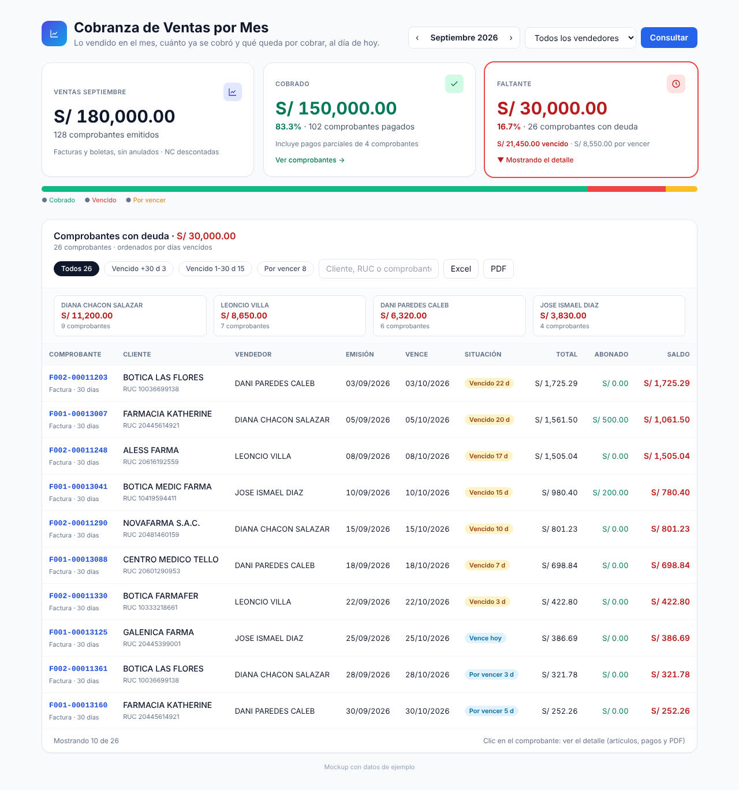
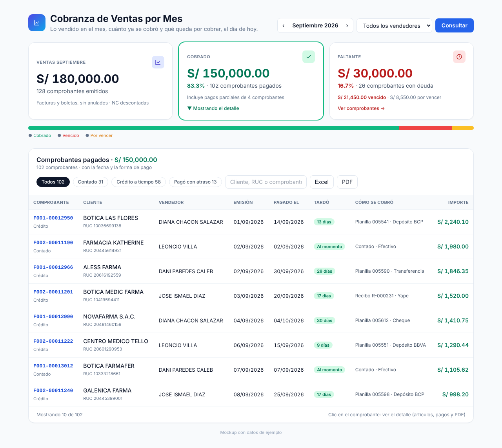
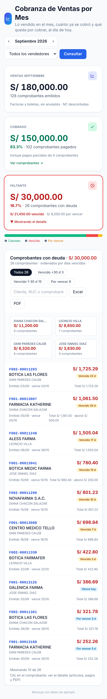

# Handoff: módulo "Cobranza de Ventas por Mes"

**Estado:** planteado y con mockup aprobado para revisión. **No implementado.**
**Fecha:** 25/10/2026
**Repos afectados:** base de datos (SP nuevo), backend (`difar-order-system-backend`) y front (`difar-order-system`).

## Qué pidió el negocio

Filtrar por mes las ventas realizadas y ver:

- **Ventas del mes** (por ejemplo, septiembre: S/ 180,000)
- **Cobrado** (S/ 150,000)
- **Faltante** (S/ 30,000)

Al hacer clic en **Cobrado**: los comprobantes pagados. Al hacer clic en **Faltante**: los comprobantes con deuda. En ambos casos con su detalle: vendedor, cliente, días vencidos, etc.

## Mockup

| Faltante seleccionado | Cobrado seleccionado | Celular |
|---|---|---|
|  |  |  |

`mockup.html` es la maqueta navegable (abre con `?v=faltante` o `?v=cobrado`).

### Pantalla

- **Filtros:** mes (flechas ‹ ›) y vendedor (opcional).
- **Tres tarjetas:** Ventas del mes (monto y n.º de comprobantes), Cobrado (monto, %, n.º pagados) y Faltante (monto, %, separado en vencido y por vencer).
- **Barra de avance:** verde cobrado, rojo vencido, amarillo por vencer.
- **Clic en Faltante:** comprobantes con deuda, del más atrasado al menos atrasado. Columnas: comprobante, cliente/RUC, vendedor, emisión, vencimiento, situación (Vencido N d / Vence hoy / Por vencer N d), total, abonado, saldo. Filtros rápidos: Vencido +30 d, Vencido 1–30 d, Por vencer. Resumen de deuda por vendedor.
- **Clic en Cobrado:** comprobantes pagados. Columnas: fecha de pago, días que tardó, cómo se cobró (planilla, recibo, depósito, Yape, contado), importe. Filtros rápidos: Contado, Crédito a tiempo, Pagó con atraso.
- **En ambas listas:** buscador (cliente, RUC, comprobante), exportar Excel y PDF; clic en el comprobante abre su detalle (artículos, pagos, PDF).
- **Celular:** tarjetas apiladas; la tabla pasa a tarjetas por comprobante.

## Diseño técnico propuesto

1. **Base de datos:** SP nuevo (nombre sugerido `sp_ws_rpt_cobranza_ventas_mes(p_anio, p_mes, p_cod_vend)`) que cruce en una sola consulta:
   - los comprobantes emitidos en el mes (misma fuente que `sp_ws_rpt_registro_ventas_comprobantes`);
   - su saldo actual en cuenta corriente (misma lógica que `sp_ws_rpt_saldo_x_cliente`);
   - sus pagos/amortizaciones (fecha, planilla/recibo, forma de pago).

   Por comprobante: documento, tipo, condición, emisión, vencimiento, cliente, RUC, vendedor, moneda, total, cobrado, saldo, días vencidos, fecha del último pago y forma de cobro.
   No toca tablas ni SPs existentes. Se entrega como script SQL para ejecutar a mano, más el INSERT de la ruta en la tabla de menús y su asignación a roles.
2. **Backend:** endpoint y controlador nuevos (sin modificar los existentes). Permisos: el vendedor solo ve lo suyo; administración y gerencia ven todo.
3. **Front:** página nueva en el menú, con el estilo y el modo nocturno del resto. Componentes y hook propios (tarjetas, listas, filtros, exportación).

**Orden de subida:** SQL → backend → front.

## Decisiones pendientes (preguntar antes de implementar)

1. ¿"Cobrado" se calcula **a la fecha de hoy** (de lo vendido en el mes, cuánto se cobró hasta hoy) o a fin de ese mes?
2. ¿Las **notas de crédito** se restan de las ventas del mes?
3. ¿Las ventas **al contado** cuentan como cobradas?
4. ¿Los comprobantes en **dólares** se convierten a soles o se muestran aparte?
5. ¿**Quién lo ve**? ¿Solo gerencia y administración, o también los vendedores (cada uno lo suyo)?
6. Falta el cuerpo de `sp_ws_rpt_saldo_x_cliente` (`SHOW CREATE PROCEDURE sp_ws_rpt_saldo_x_cliente;`) para reutilizar su lógica de saldo por documento.
